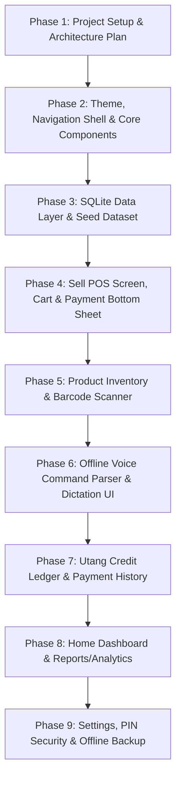
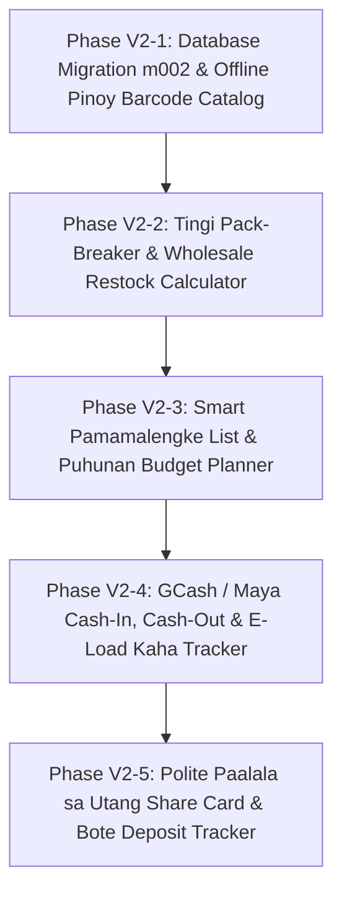

# System Requirements Document (SRD)
**Project Name:** Tindahan — Offline Sari-Sari Store Management System  
**Platform:** Android (Android 8.0+ / API 26+, optimized for 2 GB RAM low-end devices)  
**Technology Stack:** Flutter (Dart), Material 3, Provider, SQLite (`sqflite`), Offline Speech-to-Text (`speech_to_text`), Camera Barcode Scanner (`mobile_scanner`)  
**Network Requirement:** 100% Offline (No internet permission requested or required)  

---

## 1. Executive Summary & Target User Profile

### 1.1 Project Overview
**Tindahan** is a high-speed, offline-first mobile Point of Sale (POS), inventory management, and customer credit (*utang*) ledger specifically tailored for Philippine neighborhood retail micro-enterprises (*sari-sari stores*). It completely replaces the traditional paper notebook (*cuaderno / listahan*) with zero monthly fees, zero server costs, and no dependency on internet connectivity.

### 1.2 Target User Persona
- **User:** Non-technical sari-sari store owner or neighborhood helper (*tindero / tindera*).
- **Environment:** Bright outdoor sunlight, dim evening store lighting, loud street noise.
- **Physical Context:** One-handed operation while simultaneously grabbing items, counting change, or attending to customers.
- **Ergonomics:** Large touch targets ($\ge 48\times48\text{ dp}$), 2 to 3 taps to complete any core transaction, high visual contrast, and immediate haptic feedback.

---

## 2. Business Requirements (BR)

* **BR1: Replace the Paper Notebook (*Cuaderno*):** Provide a digital, single-source-of-truth ledger for stock levels, daily cash sales, and credit balances.
* **BR2: Eliminate Invisible Financial Leaks:**
  1. *Forgotten / Unrecorded Utang:* Customers walking away without purchases being listed.
  2. *Household Consumption ("Kuha sa Sarili"):* Store owners taking goods for home cooking/snacks without recording cost.
  3. *Spoilage and Damage:* Expired items, cracked eggs, or damaged packaging.
  4. *Calculation Errors:* Mistakes in calculating total cost and change during rush periods.
* **BR3: Cash-Drawer Accuracy (*Kaha vs. Benta*):** Reconcile end-of-day drawer cash against calculated sales, accounting for morning change float (*panukli*) and vendor payouts.
* **BR4: Zero Connectivity Dependence:** All modules operate seamlessly without mobile data, Wi-Fi, or SIM cards.
* **BR5: Zero Ongoing Overhead:** 100% free with no monthly subscription fees, cloud hosting, or server costs.
* **BR6: Smooth Budget Hardware Performance:** Runs reliably on ultra-low-budget Android smartphones ($< 2\text{ GB}$ available RAM, Android Go editions).

---

## 3. Functional Requirements (FR)

### 3.1 Product & Inventory Management (*Tinda at Stocks*)
* **FR-INV-01: Product Catalog Management:** Add, edit, archive, and delete products with:
  * Product Name
  * Selling Price (₱)
  * Cost Price / Puhunan (₱)
  * Current Stock Quantity
  * Low-Stock Alert Threshold
  * Category (e.g., Canned Goods, Instant Noodles, Beverages, Snacks, Personal Care, Household)
  * Barcode (optional)
  * Pieces per Pack (for *tingi* conversions)
* **FR-INV-02: Tingi & Pack Hierarchy (Unit Conversions):**
  * Support linked inventory where items can be sold individually or by whole pack (e.g., 1 pack of 20 cigarette sticks or 1 ream of 10 packs; 1 box of 12 shampoo sachets).
  * Automatically deduct or open a pack when individual pieces run out.
* **FR-INV-03: Variable / Loose Pricing (*Timbang / Patingi*):**
  * Direct custom-entry sale for unpackaged goods (e.g., ₱10 cooking oil, ₱20 sugar, ₱5 ice bag).
* **FR-INV-04: Fast Restocking:**
  * Quick stock replenishment workflow: input quantity added with optional cost adjustment.
* **FR-INV-05: Spoilage & Personal Consumption Logging:**
  * Deduct inventory with reasons (*Tapon / Basag / Expiry / Gamit sa Bahay*) to ensure stock counts remain accurate without skewing sales revenue.
* **FR-INV-06: Pre-Seeded Product Library:**
  * Pre-populate the app on first launch with 15–20 common Philippine sari-sari store items (Lucky Me Pancit Canton, Coke Mismo, Piattos, Kopiko 3-in-1, Safeguard, Bear Brand, etc.) so the store is instantly usable.

### 3.2 Point of Sale & Checkout (*Benta at Panukli*)
* **FR-POS-01: Visual Quick-Add Grid:**
  * Fast-moving items displayed as large, color-coded visual tiles for 1-tap addition to cart.
  * Long-press tile to manually enter a specific quantity.
* **FR-POS-02: Fast Search & Barcode Scan:**
  * Instant search bar filtering by name.
  * Integrated offline camera barcode scanner (`mobile_scanner`) in a bottom sheet with torch/flashlight toggle and manual barcode entry fallback.
* **FR-POS-03: Interactive Cart Drawer:**
  * Draggable bottom sheet with item list, $+/-$ stepper controls, swipe-to-remove with undo snackbar.
  * Live total calculation formatted in Philippine Peso (e.g., `₱1,250.50`).
  * Stock validation: alerts if quantity exceeds available stock.
* **FR-POS-04: Fast Cash Tender & Change Calculator:**
  * Preset quick-denomination buttons: **Exact**, **₱20**, **₱50**, **₱100**, **₱200**, **₱500**, **₱1,000**.
  * Instant calculation of change (*sukli*) displayed in large, bold font.
* **FR-POS-05: Manual Open-Price Item ("Manual Benta"):**
  * Add an ad-hoc amount to the cart (e.g., ₱35) without needing to configure a product record first.
* **FR-POS-06: Park / Hold Cart:**
  * Save a customer's active cart temporarily when they leave the counter to grab another item, allowing another customer to be served immediately.
* **FR-POS-07: Void / Return Sale:**
  * Ability to cancel or void a previous sale with automatic inventory replenishment.

### 3.3 Customer Credit Ledger (*Listahan ng Utang*)
* **FR-CRD-01: Customer Profile Management:**
  * Name, Nickname / Alias (*Alyas*), and optional contact number.
  * Color-coded credit status chip (*Good*, *Watch*, *High Risk*).
* **FR-CRD-02: Charge Cart to Utang:**
  * Convert any active checkout into an itemized credit entry assigned to a specific customer.
* **FR-CRD-03: Partial & Full Debt Payments:**
  * Log debt payments (partial or full).
  * Handle overpayments by issuing change or storing surplus as store advance credit.
* **FR-CRD-04: Itemized Audit Trail:**
  * Timeline view per customer showing dates, itemized purchases, payments made, and running balance.
* **FR-CRD-05: Shareable Debt Statement:**
  * Generate a clean plain-text receipt summary or image ready to copy/share via SMS, Messenger, or Bluetooth printer once a device is near a signal or connection.

### 3.4 Hands-Free Voice Input (*Boses / Voice Commands*)
* **FR-VOX-01: 100% Offline Speech Recognition:**
  * Powered by `speech_to_text` using local offline speech engines (checking for `fil-PH`, `en-PH`, `en-US` on-device models).
  * Requests microphone permission only; **no internet permission or remote APIs**.
* **FR-VOX-02: Multilingual Tagalog / English Parsing (`VoiceCommandParser`):**
  * Number words conversion (e.g., *isa*, *dalawa*, *tatlo*, *apat*, *lima*, *anim*, *pito*, *walo*, *siyam*, *sampu*, *labindalawa*, *dalawampu*, *dosena*, *bente*, *singkwenta*, *isang daan*).
  * Intent recognition keywords:
    * **Restock:** *"Add 10 Coke Mismo"*, *"Dagdag sampung Piattos"*
    * **Batch Restock:** *"Sampung Coke, lima Piattos, dalawang kape"*
    * **New Product:** *"Bagong produkto, Lucky Me Pancit Canton, presyo 12, stock 20"*
    * **Search:** *"Hanap Safeguard"*
* **FR-VOX-03: Confirmation & Safety Flow:**
  * **Strict Rule:** Voice commands NEVER commit directly to the database.
  * Always opens an editable confirmation bottom sheet showing matched product candidates, detected quantity, and price. The owner can tap **Confirm** or **Cancel**.
  * Shows top 3 fuzzy-matched candidate products if confidence is below threshold.
* **FR-VOX-04: Graceful Fallback:**
  * If the microphone is unavailable, permission is denied, or offline voice packs are missing, guide the user to download the offline language pack and smoothly fall back to manual typing.

### 3.5 Cash Drawer & Shift Reconciliation (*Balanseng Kaha*)
* **FR-CSH-01: Opening Cash Float (*Panukli*):** Log initial coin and small bill starter balance.
* **FR-CSH-02: Supplier Payouts (*Bayad sa Ahente / Delivery*):** Log disbursements from the cashbox for bread, beverage, or ice deliveries.
* **FR-CSH-03: End-of-Day Balancing:**
  * Formula:
    $$\text{Expected Cash} = \text{Opening Float} + \text{Cash Sales} + \text{Debt Collected} - \text{Cash Out / Expenses}$$
  * Compares counted physical cash against expected cash and displays difference (*Sobra / Kulang*).

### 3.6 Reports & Analytics (*Ulat at Kita*)
* **FR-REP-01: Summary Dashboards:** Day, Week, and Month filters.
* **FR-REP-02: Profit Calculation:** Gross Sales minus Cost of Goods Sold (COGS) minus recorded store expenses.
* **FR-REP-03: Sales Velocity & Best-Sellers:** Ranked list of top-selling products by quantity and revenue.
* **FR-REP-04: Restock Shopping Checklist (*Listahan sa Palengke*):**
  * One-tap aggregated list of all items currently below their designated low-stock alert thresholds.
* **FR-REP-05: Outstanding Credit Summary:** Total unpaid utang and aging analysis (unsettled for 15+ or 30+ days).

### 3.7 Settings & Data Administration
* **FR-SET-01: Store Profile:** Customizable store name and low-stock default threshold.
* **FR-SET-02: Security PIN Lock:** Optional 4-digit PIN protecting settings, cost prices, and financial reports from store helpers (*tindera mode*).
* **FR-SET-03: Offline Backup & Restore:**
  * One-tap export to JSON/CSV in local device storage or SD card.
  * Restore function from local file backup.
* **FR-SET-04: Theme & Language Preferences:**
  * Light / Dark / System mode toggle.
  * English / Tagalog language toggle with all strings centralized in a localization bundle.

---

## 4. Non-Functional Requirements (NFR)

| Metric | Requirement | Verification Method |
| :--- | :--- | :--- |
| **Offline Independence** | App manifests request zero network permissions (`android.permission.INTERNET` omitted). Zero remote calls. | AndroidManifest audit & network monitoring |
| **Launch Performance** | Cold start to usable dashboard $< 2.0\text{ s}$ on a 2GB RAM Android device. | Profile mode benchmarking |
| **Transaction Latency** | Cart tap-to-add $< 100\text{ ms}$; checkout commit $< 500\text{ ms}$. | Stopwatch & frame render metrics |
| **Frame Rate** | Steady 60 fps during scrolling and animations; use `const` widgets and `ListView.builder`. | Flutter DevTools Performance overlay |
| **Data Integrity** | ACID compliance via SQLite database transactions; stock deduction and sales record committed atomically. | Fault injection / crash testing mid-sale |
| **App Bundle Size** | Download/install size $< 30\text{ MB}$; no network fonts (embedded local Nunito/Poppins assets). | APK analyzer |
| **Accessibility & Contrast** | Meets WCAG AA contrast ratio standards; all touch targets $\ge 48\times48\text{ dp}$ (main buttons $56\text{ dp}$). | Accessibility scanner |
| **Compatibility** | Android 8.0 (API level 26) through Android 15+. Responsive down to 360 dp screen width. | Emulators and low-end hardware testing |

---

## 5. UI/UX Design System Specification

### 5.1 Color Tokens
* **Primary (Store Green):** `#2E7D32` (Light) / `#81C784` (Dark) — Action buttons, money, success.
* **Accent (Warning Amber):** `#FFB300` (Light) / `#FFD54F` (Dark) — Highlights, low-stock warnings, alerts.
* **Danger (Soft Red):** `#D32F2F` (Light) / `#E57373` (Dark) — Critical stockouts, overdue utang, destructive actions.
* **Background Surface:** `#FAF7F2` (Warm Off-White) / `#121212` (Deep Charcoal for Dark Mode).
* **Card Surface:** `#FFFFFF` (Light) / `#1E1E1E` (Dark).

### 5.2 Typography & Formatting
* **Font Family:** `Poppins` or `Nunito` (bundled locally in `assets/fonts/`, strictly no Google Fonts runtime HTTP fetching).
* **Currency Display:** Philippine Peso formatted with symbol, commas, and two decimals (e.g., `₱1,250.50`).
* **Visual States:**
  * Animated number count-up on dashboard load.
  * Shimmer/skeleton loaders during SQLite query resolution.
  * Empty states featuring friendly illustrations and clear call-to-action buttons.
  * Haptic feedback on button clicks, barcode recognition, and checkout confirmation.

### 5.3 Information Architecture & Navigation Shell
Bottom Navigation with 5 primary destinations:
1. **Home:** Overview cards (Today's Sales, Profit, Items Sold, Unpaid Utang), 7-day mini bar chart, quick action shortcuts.
2. **Sell:** Central emphasized action button; quick-pick product grid, search/scan bar, cart drawer, and payment sheet.
3. **Products:** Category filter chips, low-stock filter, stock health indicators (Green/Amber/Red), Add/Edit, and Voice Entry.
4. **Utang:** Outstanding balance header, customer list with risk status chips, itemized ledger history, payment recorder.
5. **Reports:** Tabbed metrics (Day / Week / Month), sales vs. profit charts, best-sellers, market shopping list.

---

## 6. Data Architecture & Database Schema

The database is built on SQLite via `sqflite` with foreign key enforcement and transactional integrity.

### 6.1 Entity Relational Schema

```sql
-- Products & Tingi Hierarchy
CREATE TABLE products (
    id INTEGER PRIMARY KEY AUTOINCREMENT,
    name TEXT NOT NULL,
    barcode TEXT UNIQUE,
    price REAL NOT NULL,
    cost REAL NOT NULL,
    stock REAL NOT NULL DEFAULT 0,
    low_stock_level REAL NOT NULL DEFAULT 5,
    category TEXT NOT NULL DEFAULT 'General',
    pieces_per_pack INTEGER DEFAULT 1,
    parent_product_id INTEGER,
    created_at DATETIME DEFAULT CURRENT_TIMESTAMP,
    updated_at DATETIME DEFAULT CURRENT_TIMESTAMP,
    FOREIGN KEY (parent_product_id) REFERENCES products(id) ON DELETE SET NULL
);

-- Customers / Debtors
CREATE TABLE customers (
    id INTEGER PRIMARY KEY AUTOINCREMENT,
    name TEXT NOT NULL,
    nickname TEXT,
    phone TEXT,
    credit_limit REAL DEFAULT 0,
    created_at DATETIME DEFAULT CURRENT_TIMESTAMP
);

-- Sales Transactions
CREATE TABLE sales (
    id INTEGER PRIMARY KEY AUTOINCREMENT,
    sale_number TEXT UNIQUE NOT NULL,
    total_amount REAL NOT NULL,
    payment_type TEXT NOT NULL CHECK(payment_type IN ('CASH', 'UTANG')),
    customer_id INTEGER,
    amount_paid REAL NOT NULL DEFAULT 0,
    change_given REAL NOT NULL DEFAULT 0,
    status TEXT NOT NULL DEFAULT 'COMPLETED' CHECK(status IN ('COMPLETED', 'VOIDED')),
    created_at DATETIME DEFAULT CURRENT_TIMESTAMP,
    FOREIGN KEY (customer_id) REFERENCES customers(id) ON DELETE SET NULL
);

-- Itemized Sales Items
CREATE TABLE sale_items (
    id INTEGER PRIMARY KEY AUTOINCREMENT,
    sale_id INTEGER NOT NULL,
    product_id INTEGER,
    product_name TEXT NOT NULL,
    quantity REAL NOT NULL,
    unit_price REAL NOT NULL,
    unit_cost REAL NOT NULL,
    subtotal REAL NOT NULL,
    FOREIGN KEY (sale_id) REFERENCES sales(id) ON DELETE CASCADE,
    FOREIGN KEY (product_id) REFERENCES products(id) ON DELETE SET NULL
);

-- Utang Repayment Ledger
CREATE TABLE utang_payments (
    id INTEGER PRIMARY KEY AUTOINCREMENT,
    customer_id INTEGER NOT NULL,
    amount REAL NOT NULL,
    notes TEXT,
    payment_date DATETIME DEFAULT CURRENT_TIMESTAMP,
    FOREIGN KEY (customer_id) REFERENCES customers(id) ON DELETE CASCADE
);

-- Cash Float & Daily Drawer Sessions
CREATE TABLE cash_sessions (
    id INTEGER PRIMARY KEY AUTOINCREMENT,
    opening_float REAL NOT NULL DEFAULT 0,
    cash_expenses REAL NOT NULL DEFAULT 0,
    counted_cash REAL,
    status TEXT NOT NULL DEFAULT 'OPEN' CHECK(status IN ('OPEN', 'CLOSED')),
    opened_at DATETIME DEFAULT CURRENT_TIMESTAMP,
    closed_at DATETIME
);
```

---

## 7. Implementation Roadmap & Verification Gates



### Review & Quality Checkpoints
1. **Gate A (Architecture & Shell):** Propose project folder structure, typography, tokens, and navigation shell.
2. **Gate B (Data Layer & Transactions):** Validate SQLite migrations, foreign keys, and atomic checkout transactions.
3. **Gate C (POS Execution):** Test 2-tap sale execution, quick cash chips, and stock deduction.
4. **Gate D (Barcode & Voice):** Test camera scanner fallback and verify `VoiceCommandParser` unit tests across 15+ English and Tagalog phrases.
5. **Gate E (Credit & Reports):** Validate itemized debt calculation, partial payments, and profit formula accuracy.
6. **Gate F (Static Analysis):** Clean `flutter analyze` with zero errors or warnings before final release.

---

## 8. Version 2.0 (`v2.0`) System Requirements & Innovation Roadmap

This section defines the complete functional, UX, and database requirements for **SariMe Version 2.0 (`v2.0`)**, specifically tailored to solve daily operational pain points of Filipino *sari-sari* store owners.

### 8.1 Functional Requirements (v2.0 Modules)

#### FR-V2-01: *"Tingi-Tingi" & Sachet Pack-Breaker* (Bulk-to-Retail Auto-Converter)
* **Problem Solved:** Store owners buy wholesale cases/ties/sacks (e.g., 1 case = 72 packs, 1 tie = 12 sachets, 1 sack = 25 kg) at wholesale markets (*Puregold / SuySing / Divisoria*) but sell per piece, per *takal*, or fractional weight (`1/4 kg`, `1/2 kg`).
* **Requirements:**
  1. **Wholesale Restock Calculator:** Allow entering `Wholesale Pack Qty` (e.g., `1 case`), `Units per Pack` (e.g., `72 pcs`), and `Total Wholesale Cost` (e.g., `₱792.00`).
  2. **Auto-Unit Cost Computation:** Automatically calculate `unit_cost_cents = round(total_wholesale_cost_cents / units_per_pack)` (`₱11.00/pc`) and increment retail stock by `72`.
  3. **Fractional / *Tingi* Preset Buttons:** Support fractional unit selling (`1/4`, `1/2`, `1 takal`, `1 tie`) for bulk commodities like rice, cooking oil, sugar, and eggs.

#### FR-V2-02: *Smart "Pamamalengke" List* (Auto-Generated Grocery & Budget Planner)
* **Problem Solved:** Storekeepers forget which items are critically low when visiting the wholesaler and run out of cash (*kapital*) at checkout when supplier prices fluctuate.
* **Requirements:**
  1. **1-Tap Auto-Generation:** Automatically populate a shopping list from products where `stock <= low_stock_threshold`, sorted by 7-day sales velocity (fastest-moving items first).
  2. **Estimated *Puhunan* Budget Calculator:** Sum `recommended_restock_qty * last_cost_cents` so the owner knows the exact cash budget needed before leaving for the market.
  3. **In-Aisle Checklist & Live Restock Commit:** Interactive checkboxes while shopping; tapping **"Tapos na Mamalengke (Commit to Stock)"** updates inventory quantities and logs all restock movements in a single batch transaction.

#### FR-V2-03: *GCash / Maya Cash-In, Cash-Out & E-Load "Kaha" Tracker*
* **Problem Solved:** Neighborhood stores earn daily income from GCash/Maya Cash-In/Cash-Out and E-Load service fees (*patong*), but owners frequently mix up physical cash drawer balances with e-wallet balances.
* **Requirements:**
  1. **Dual Balance Tracking:** Maintain separate running balances for **Physical Cash Drawer (*Kaha*)** and **E-Wallet Float (*GCash / Maya / Load Wallet*)**.
  2. **Transaction Rules:**
     - **Cash-In:** Decreases E-Wallet balance by principal, increases Physical Cash by `principal + fee_cents`, and logs `fee_cents` as pure net profit.
     - **Cash-Out:** Increases E-Wallet balance by principal, decreases Physical Cash by `principal` (or `principal - fee_cents`), and logs `fee_cents` as net profit.
  3. **Configurable Fee Tiers:** Auto-compute standard *sari-sari* fee tiers (e.g., `₱1–₱500 = ₱10 fee`, `₱501–₱1,000 = ₱20 fee`, or custom `2%`).

#### FR-V2-04: *Polite "Paalala sa Utang" Card Generator* (Messenger / SMS Share)
* **Problem Solved:** Cultural hesitation (*hiya*) when reminding neighbors and *suki* about overdue credit (*utang*).
* **Requirements:**
  1. **Friendly Digital Statement Card:** Generate a clean, non-confrontational bilingual summary card or text message showing the store name, itemized *utang* balance, last payment (*hulog*), and due date.
  2. **1-Tap Native Share (`share_plus`):** Share directly to Facebook Messenger, Viber, or SMS with polite Tagalog/English templates (e.g., *"Magandang araw po! Narito po ang updated digital listahan mula sa SariMe Store. Maraming salamat po sa patuloy na pagtangkilik!"*).

#### FR-V2-05: *Bote / Container Deposit Tracker* (Returnable Glass Bottles & Water Gallons)
* **Problem Solved:** Financial loss from unreturned returnable glass softdrink/beer bottles (*Coke Mismo/8oz, Red Horse Mucho*) and 5-gallon water containers.
* **Requirements:**
  1. **Borrow / Deposit Toggle at Checkout:** Quick toggle to record borrowed bottles/gallons, optional customer name, and bottle deposit amount (`₱5–₱20/bote`).
  2. **1-Tap Return Resolution:** Mark bottles as returned (refunding deposit if applicable) and show total unreturned bottles on the Home Dashboard.

#### FR-V2-06: *Pre-Loaded "Pinoy Paninda" Offline Barcode Dictionary (500+ Items)*
* **Problem Solved:** Slow initial onboarding when registering hundreds of common grocery items manually.
* **Requirements:**
  1. **Bundled Offline Barcode Catalog:** Include a lightweight local JSON/SQLite lookup table of 500+ common Philippine FMCG barcodes (instant noodles, canned goods, 3-in-1 coffee, laundry sachets, condiments, beverages).
  2. **Auto-Fill on First Scan:** Scanning an unknown barcode checks the offline catalog and pre-fills the **Product Name**, **Category**, and **Suggested Unit**—requiring the owner to only enter their selling price and current stock.

---

### 8.2 Version 2.0 SQLite Schema Extensions (`m002_v2_features.dart`)

```sql
-- 1. E-Wallet & Load Float Accounts (GCash, Maya, Load Wallet)
CREATE TABLE ewallet_accounts (
    id INTEGER PRIMARY KEY AUTOINCREMENT,
    provider_name TEXT NOT NULL, -- 'GCash', 'Maya', 'Smart/Globe Load'
    balance_cents INTEGER NOT NULL DEFAULT 0,
    updated_at TEXT NOT NULL
);

-- 2. E-Wallet Cash-In / Cash-Out / E-Load Transactions
CREATE TABLE ewallet_transactions (
    id INTEGER PRIMARY KEY AUTOINCREMENT,
    account_id INTEGER NOT NULL,
    tx_type TEXT NOT NULL CHECK(tx_type IN ('cash_in', 'cash_out', 'eload', 'topup')),
    principal_cents INTEGER NOT NULL,
    fee_cents INTEGER NOT NULL DEFAULT 0,
    customer_note TEXT,
    created_at TEXT NOT NULL,
    FOREIGN KEY (account_id) REFERENCES ewallet_accounts(id) ON DELETE CASCADE
);

-- 3. Returnable Bottle / Gallon Container Ledger (Bote Tracker)
CREATE TABLE bottle_deposits (
    id INTEGER PRIMARY KEY AUTOINCREMENT,
    borrower_name TEXT NOT NULL,
    customer_id INTEGER,
    item_description TEXT NOT NULL, -- e.g. 'Coke 8oz Case (12 bote)', '5-Gal Water Jug'
    qty INTEGER NOT NULL CHECK(qty > 0),
    deposit_cents INTEGER NOT NULL DEFAULT 0,
    status TEXT NOT NULL DEFAULT 'borrowed' CHECK(status IN ('borrowed', 'returned')),
    borrowed_at TEXT NOT NULL,
    returned_at TEXT,
    FOREIGN KEY (customer_id) REFERENCES customers(id) ON DELETE SET NULL
);

-- 4. Smart Pamamalengke (Restock Shopping List)
CREATE TABLE shopping_list_items (
    id INTEGER PRIMARY KEY AUTOINCREMENT,
    product_id INTEGER,
    product_name TEXT NOT NULL,
    target_qty INTEGER NOT NULL DEFAULT 1,
    estimated_unit_cost_cents INTEGER NOT NULL DEFAULT 0,
    actual_total_cost_cents INTEGER,
    is_purchased INTEGER NOT NULL DEFAULT 0,
    created_at TEXT NOT NULL,
    FOREIGN KEY (product_id) REFERENCES products(id) ON DELETE SET NULL
);

-- 5. Offline Pinoy Paninda Barcode Reference Dictionary
CREATE TABLE barcode_catalog (
    barcode TEXT PRIMARY KEY,
    default_name TEXT NOT NULL,
    category_name TEXT NOT NULL,
    pack_size_hint INTEGER NOT NULL DEFAULT 1
);
```

---

### 8.3 Version 2.0 Implementation Phases



